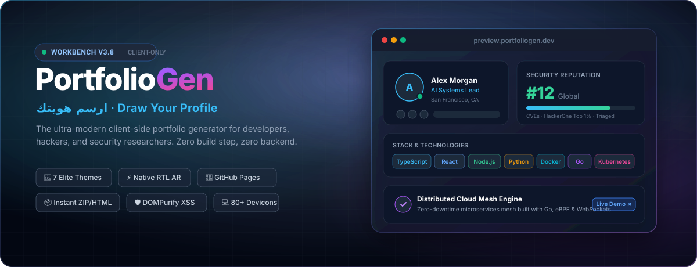

<p align="center">
  <a href="https://universal-portfolio-generator.vercel.app" target="_blank" rel="noopener">
    
  </a>
</p>

<h2 align="center">Universal Portfolio Generator</h2>

<p align="center">
  Client-side studio to build, preview, and deploy static developer portfolios — zero backend, zero build step.
  <br><br>
  <a href="https://universal-portfolio-generator.vercel.app"><strong>Live Studio ↗</strong></a> ·
  <a href="#run-locally"><strong>Run Locally</strong></a> ·
  <a href="#json-configuration-schema"><strong>JSON Schema</strong></a> ·
  <a href="#adding-a-theme"><strong>Custom Themes</strong></a>
</p>

---

## Quick Start

### Run Locally

No build tools or `npm install` required. Serve the root directory with any static HTTP server:

```bash
git clone https://github.com/Aetherdz/universal-portfolio-generator.git
cd universal-portfolio-generator
python3 -m http.server 8080
```

Open `http://localhost:8080`.

---

## Workflow & Export Options

1. **Profile & Stack**: Fill in your profile, social links, skills, projects, work experience, education, and bug bounty platforms — or load a starter persona (`Full-Stack`, `AppSec`, `Creative UI`, `AI Researcher`).
2. **GitHub Repo Sync**: Enter a GitHub username in Step 4 to import public repositories (name, description, stars, language, URL).
3. **Preview & Theme**: Switch between the 7 themes and 10 color palettes in real time across Desktop, Tablet (`768px`), and Mobile (`375px`) viewports.
4. **Ship**:
   - **Standalone HTML**: Single self-contained `index.html` file.
   - **Production ZIP**: Archive containing `index.html`, `README.md`, and `portfolio-config.json`.
   - **GitHub Pages Deploy**: Push directly to `<username>.github.io` or any target repository using a GitHub Personal Access Token (`repo` scope).
   - **JSON Config**: Export or re-import `portfolio-config.json` to save or update your portfolio state at any time.

---

## Included Themes

| ID | Name | Layout Style | Light / Dark | RTL (`ar`) |
|:---|:---|:---|:---:|:---:|
| `aether` | **Aether** | Interactive canvas particle network & neon cards | Both | Yes |
| `terminal` | **Terminal** | Monospace CLI prompt & window chrome | Dark | Yes |
| `minimal` | **Minimal** | Clean editorial typography & whitespace | Both | Yes |
| `bento` | **Bento Grid** | Asymmetric multi-card bento grid | Dark | Yes |
| `glassmorphic` | **Glassmorphic** | Backdrop blur panels (`blur`, `opacity`, `radius` controls) | Dark | Yes |
| `dark-premium` | **Dark Premium** | Obsidian grid layout with high-contrast accents | Dark | Yes |
| `academic` | **Academic** | Formal CV, research timeline, and publications | Light | Yes |

---

## Keyboard Shortcuts

| Shortcut | Action |
|:---|:---|
| `⌘K` / `Ctrl+K` | Open Command Palette (jump to steps, switch themes, load personas, export) |
| `↑` / `↓` | Navigate Command Palette items |
| `Enter` | Execute selected command |
| `Esc` | Close active modal or Command Palette |

---

## JSON Configuration Schema

You can import a `.json` file directly from the top bar (`Import JSON`). Minimal structure:

```json
{
  "name": "Alex Morgan",
  "role": "Systems & Security Engineer",
  "bio": "Building distributed systems and auditing web applications.",
  "location": "Algiers, DZ",
  "email": "alex@example.com",
  "github": "https://github.com/Aetherdz",
  "skills": ["Rust", "Go", "TypeScript", "Linux", "Docker", "Burp Suite"],
  "projects": [
    {
      "title": "Universal Portfolio Generator",
      "description": "Client-side portfolio workbench with 7 themes.",
      "tech": "JavaScript, CSS, HTML5",
      "link": "https://github.com/Aetherdz/universal-portfolio-generator"
    }
  ],
  "experience": [
    {
      "role": "Senior Engineer",
      "company": "Acme Corp",
      "period": "2023 - Present",
      "description": "Core infrastructure and security automation."
    }
  ],
  "education": [
    {
      "degree": "M.Sc. Computer Science",
      "institution": "USTHB",
      "year": "2023"
    }
  ],
  "theme": "bento",
  "palette": "sapphire",
  "portfolioLang": "en"
}
```

---

## Adding a Theme

1. Create `js/themes/custom.js`:

```javascript
ThemeRegistry.register({
  id: 'custom',
  nameKey: 'theme.custom',
  icon: 'fas fa-code',
  render: function (data) {
    return Handlebars.compile(`
      <!DOCTYPE html>
      <html lang="{{lang}}" dir="{{dir}}">
      <head>
        <meta charset="UTF-8">
        <meta name="viewport" content="width=device-width, initial-scale=1.0">
        <title>{{name}} — {{role}}</title>
      </head>
      <body style="background:{{colors.bg}};color:{{colors.text}}">
        <h1>{{name}}</h1>
        <p>{{role}}</p>
      </body>
      </html>
    `)(data);
  }
});
```

2. Add the script tag to `index.html`:

```html
<script src="js/themes/custom.js"></script>
```

---

## Project Structure

```text
├── index.html               # Workbench UI shell
├── css/
│   ├── tokens.css           # Color, spacing, and typography tokens
│   ├── components.css       # Buttons, inputs, cards, modals
│   ├── studio.css           # 3-pane workbench & device simulator
│   └── style.css            # Base resets & RTL adjustments
└── js/
    ├── app.js               # Studio bootstrap & Command Palette (⌘K)
    ├── design-tokens.js     # Color palettes & font pairings
    ├── form.js              # Form coordinator
    ├── preview.js           # Live iframe renderer & viewport switcher
    ├── export.js            # HTML, ZIP & JSON exporters
    ├── github.js            # GitHub REST API repo sync & Pages deploy
    ├── i18n.js              # English & Arabic dictionaries
    ├── utils.js             # DOMPurify sanitization, storage & skill catalog
    ├── form/                # Reactive state & steps 1–5
    └── themes/              # ThemeRegistry + 7 portfolio templates
```

---

## License

MIT © [Aether-DZ](https://github.com/Aetherdz)
