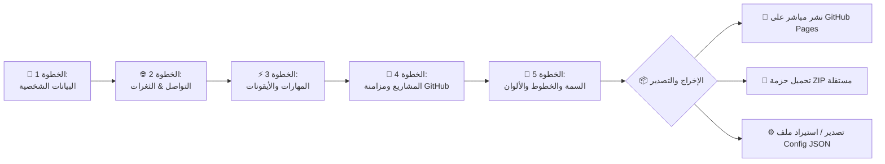

<p align="center">
  <picture>
    <source media="(prefers-color-scheme: dark)" srcset="https://img.shields.io/badge/ارسم%20هويتك%20%7C%20Draw%20Your%20Profile-0a0a0f?style=for-the-badge&labelColor=111&logo=data:image/svg+xml;base64,PHN2ZyB3aWR0aD0iNDAiIGhlaWdodD0iNDAiIHZpZXdCb3g9IjAgMCA0MCA0MCIgZmlsbD0ibm9uZSIgeG1sbnM9Imh0dHA6Ly93d3cudzMub3JnLzIwMDAvc3ZnIj48cmVjdCB3aWR0aD0iNDAiIGhlaWdodD0iNDAiIHJ4PSI4IiBmaWxsPSIjQTY3QjVCIi8+PHBhdGggZD0iTTEyIDIwaDE2TTIwIDEydjE2IiBzdHJva2U9IndoaXRlIiBzdHJva2Utd2lkdGg9IjIuNSIgc3Ryb2tlLWxpbmVjYXA9InJvdW5kIi8+PHBhdGggZD0iTTE0IDE0bDEyIDEyTTI2IDE0bC0xMiAxMiIgc3Ryb2tlPSJ3aGl0ZSIgc3Ryb2tlLXdpZHRoPSIxLjUiIHN0cm9rZS1saW5lY2FwPSJyb3VuZCIgb3BhY2l0eT0iMC40Ii8+PC9zdmc+">
    
  </picture>
</p>

<p align="center">
  <samp>
    <b>ارسم هويتك</b> &nbsp;·&nbsp; <b>Universal Portfolio Generator</b>
  </samp>
  <br>
  <sub>منشئ البورتفوليو الحديث للمطورين، صائدي الثغرات، والمبدعين · 100% Client-Side &amp; Privacy-First</sub>
</p>

<p align="center">
  <a href="#-key-features">✨ المميزات</a> &nbsp;·&nbsp;
  <a href="#-quick-start">🚀 البدء السريع</a> &nbsp;·&nbsp;
  <a href="#-themes-showcase">🎨 القوالب والسمات</a> &nbsp;·&nbsp;
  <a href="#-architecture--tech-stack">🧰 البنية التقنية</a> &nbsp;·&nbsp;
  <a href="#-one-click-deployment">📦 النشر المباشر</a> &nbsp;·&nbsp;
  <a href="#-developer-guide">🛠️ دليل المطورين</a>
</p>

<p align="center">
  
  
  
  
  
  
  
</p>

---

<p align="center">
  <a href="https://universal-portfolio-generator.vercel.app" target="_blank">
    
  </a>
  &nbsp;
  <a href="https://portfolio-generat.netlify.app" target="_blank">
    
  </a>
  &nbsp;
  <a href="https://aetherdz.github.io/universal-portfolio-generator" target="_blank">
    
  </a>
</p>

<p align="center">
  🌐 <b>الروابط الحية المباشرة (Live Demonstrations):</b><br>
  <code>https://universal-portfolio-generator.vercel.app</code> &nbsp;|&nbsp;
  <code>https://portfolio-generat.netlify.app</code> &nbsp;|&nbsp;
  <code>https://aetherdz.github.io/universal-portfolio-generator</code>
</p>

---

## 💡 نظرة عامة (Overview)

**Universal Portfolio Generator** (ارسم هويتك) هو تطبيق ويب متكامل ومفتوح المصدر يتيح للتقنيين، المطورين، صائدي الثغرات (Bug Bounty Hunters)، والباحثين إنشاء معرض أعمال (Portfolio) تفاعلي واحترافي في دقائق معدودة، مباشرة من المتصفح، ودون الحاجة لأي خادم خلفي (Serverless) أو خطوات بناء معقدة (No Bundlers / No Build Steps).

### ✨ الفلسفة الجوهرية (Core Philosophy)
* **Zero Configuration & Instant Execution**: يعمل مباشرة عبر المتصفح (Pure HTML5, Vanilla JavaScript, CSS3).
* **100% Client-Side Privacy**: بياناتك ورموز الوصول (GitHub Personal Access Tokens) لا تغادر متصفحك أبداً ولا تُخزن في أي قاعدة بيانات خارجية.
* **Native RTL & Dual Language**: دعم حقيقي للغة العربية من اليمين لليسار (RTL) بالإضافة للإنجليزية، مع محاذاة تلقائية للمحتوى.
* **Specialized Profiles**: دعم مخصص لأقسام صائدي الثغرات (HackerOne, Bugcrowd, CVEs, Stats) والباحثين الأكاديميين بجانب المطورين.

---

## ✨ المميزات الرئيسية (Key Features)

```
┌─────────────────────────────────────────────────────────────────────────────────┐
│ 🎨 7 قوالب متطورة (7 Ultra-Modern Themes)                                        │
│  ▸ Aether: تصميم سايبربنك مع توهج نيون وجزيئات تفاعلية                          │
│  ▸ Terminal: واجهة سطر الأوامر (CLI/Hacker) لهواة الأمن السيبراني                 │
│  ▸ Minimal: بساطة نقية، ومساحات بيضاء تركز على المحتوى والطباعة                │
│  ▸ Bento Grid: أحدث أسلوب بطاقات شبكية عصرية متناسقة (Apple-style Bento)        │
│  ▸ Glassmorphic: تأثيرات الزجاج المصقول الشفاف (Frosted Glass & Depth)          │
│  ▸ Dark Premium: أناقة داكنة مع تدرجات لونية فاخرة تناسب المنتجات والمؤسسين      │
│  ▸ Academic: أسلوب كلاسيكي أكاديمي للباحثين والجامعيين مع خطوط سيريف           │
└─────────────────────────────────────────────────────────────────────────────────┘
┌─────────────────────────────────────────────────────────────────────────────────┐
│ ⚡ قدرات ذكية ومتقدمة (Smart Capabilities)                                      │
│  ▸ مزامنة GitHub الذكية: استيراد مشاريعك الحقيقية تلقائياً بنقرة واحدة           │
│  ▸ أكثر من 80 مهارة برمجية وتقنية مع كشف أيقونات Devicon تلقائياً                │
│  ▸ 8 لوحات ألوان مختارة بعناية + منتقي ألوان مخصص (Custom Hex / Color Picker)    │
│  ▸ أكثر من 16 خطاً احترافياً من Google Fonts تدعم العربية والإنجليزية             │
│  ▸ محاكي معاينة حي ثلاثي الأبعاد (Desktop · Tablet · Mobile Viewports)          │
│  ▸ حماية شاملة من هجمات XSS عبر تعقيم المدخلات باستخدام DOMPurify               │
│  ▸ تصدير وحفظ كامل: تنزيل ملف ZIP جاهز، أو ملف JSON لحفظ واستعادة إعداداتك      │
│  ▸ نشر فوري إلى GitHub Pages بنقرة زر واحدة عبر Octokit REST API                │
└─────────────────────────────────────────────────────────────────────────────────┘
```

---

## 🚀 البدء السريع (Quick Start)

### 1. الاستخدام المباشر (Online)
افتح أحد الروابط المباشرة دون الحاجة لتثبيت أي برنامج:
👉 **[جرب التطبيق الآن على Vercel](https://universal-portfolio-generator.vercel.app)**

### 2. التشغيل محلياً (Local Development)
التطبيق يعمل دون أي بيئة عمل خاصة أو تبعيات Node.js إجبارية. يكفي تشغيل خادم محلي خفيف:

```bash
# 1. استنساخ المستودع
git clone https://github.com/Aetherdz/universal-portfolio-generator.git
cd universal-portfolio-generator

# 2. تشغيل عبر Python
python3 -m http.server 8080

# أو تشغيل عبر Node.js / npx
npx serve .

# أو تشغيل عبر PHP
php -S localhost:8080
```
ثم افتح المتصفح على العنوان: `http://localhost:8080`

---

## 🎨 القوالب والسمات (Themes Showcase)

| المعرف (ID) | اسم السمة | النمط البصري | الفئة المستهدفة | دعم العربية (RTL) |
|:---:|:---|:---|:---|:---:|
| `aether` | **Aether** 🪐 | Cyberpunk / Neon Glow / Particles | مهندسو البرمجيات والتقنيون | ✅ مدعوم بالكامل |
| `terminal` | **Terminal** 💻 | Hacker CLI / Retro Monospace Green | خبراء الأمن وصائدو الثغرات | ✅ مدعوم بالكامل |
| `minimal` | **Minimal** ✨ | Clean Typography / Generous Spacing | المصممون وصناع المحتوى | ✅ مدعوم بالكامل |
| `bento` | **Bento Grid** 🔲 | High-density Modern Cards | مطورو الويب والواجهات المتعددة | ✅ مدعوم بالكامل |
| `glassmorphic` | **Glassmorphic** 🪟 | Blur backdrop / Gradients / Layering | الباحثون عن مظهر عصري فاخر | ✅ مدعوم بالكامل |
| `dark-premium` | **Dark Premium** 🌙 | Subtle borders / Gradient typography | مؤسسو المشاريع والمستقلون | ✅ مدعوم بالكامل |
| `academic` | **Academic** 🎓 | Timelines / Serif headers / Formal | الباحثون الأكاديميون وطلبة الدراسات | ✅ مدعوم بالكامل |

---

## 🗺️ خطوات رحلة البناء (Builder Workflow)



1. **البيانات الشخصية (Profile)**: الاسم، النبذة، الصورة الشخصية، التخصص، والبلد.
2. **الشبكات الاجتماعية وصيد الثغرات (Socials & Bounty)**: دعم أكثر من 20 منصة تواصل، بالإضافة لأرقام وإحصائيات HackerOne و Bugcrowd.
3. **المهارات (Skills)**: إضافة لغات البرمجة وأطر العمل مع مطابقة فورية لأيقونات Devicon الشهيرة.
4. **المشاريع (Projects)**: إضافة الروابط والوصف والوسوم، مع إمكانية جلب مستودعات GitHub تلقائياً عبر اسم المستخدم.
5. **التخصيص والمظهر (Customization)**: اختيار القالب، لوحة الألوان، الخطوط، وتعديل إعدادات التعتيم الزجاجي والأنيميشن (AOS).
6. **التصدير الفوري (Deploy & Export)**: توليد ملف HTML متكامل ومستقل بنسبة 100%، جاهز للاستضافة الفورية في أي مكان.

---

## 🧰 البنية التقنية (Architecture & Tech Stack)

```
universal-portfolio-generator/
├── index.html                 # نقطة الدخول وواجهة التطبيق الرئيسية
├── .nojekyll                  # لمنع معالجة Jekyll على GitHub Pages
├── css/
│   └── style.css              # التنسيقات العامة والتحسينات المخصصة
├── js/
│   ├── app.js                 # التهيئة الشاملة وربط الأحداث
│   ├── form.js                # إدارة النموذج متعدد الخطوات والتحقق
│   ├── design-tokens.js       # منظومة الألوان والخطوط والأبعاد
│   ├── themes.js              # محركات القوالب السبعة مع دوال التوليد
│   ├── preview.js             # محاكي العرض المباشر (Sandboxed Iframe)
│   ├── github.js              # عمليات Octokit والمزامنة والنشر
│   ├── export.js              # تصدير ملفات ZIP وتوليد الشفرة
│   ├── i18n.js                # نظام الترجمة المتكامل (عربي / إنجليزي)
│   └── utils.js               # دوال المساعدة، التعقيم الأمني، وخريطة الأيقونات
└── README.md                  # دليل المشروع والتوثيق الشامل
```

| المكون | التقنية المستخدمة | الدور في المنظومة |
|:---|:---|:---|
| **اللغة الأساسية** | Vanilla Modern JavaScript (ES6+) | أداء فائق دون أي حمولة زائدة للأطر الثقيلة |
| **محرك القوالب** | Handlebars.js (Client-side) | عزل البيانات وتوليد شفرات الـ HTML بمرونة |
| **نظام التنسيق** | Tailwind CSS CDN + Custom Variables | نظام تصميم موحد وسريع الاستجابة للوضع الليلي |
| **الأيقونات** | Devicon + Font Awesome 6 | مكتبة واسعة لتغطية جميع التقنيات والشبكات |
| **الأمان والتعقيم** | DOMPurify | تنقية شاملة لجميع نصوص المستخدم لمنع هجمات XSS |
| **الحزم المضغوطة** | JSZip + FileSaver.js | بناء وتوليد ملف ZIP كامل داخل المتصفح مباشرة |
| **التفاعل مع السحاب**| @octokit/rest | إدارة مستودعات GitHub وتفعيل GitHub Pages برمجياً |
| **الحركات البصرية** | AOS (Animate On Scroll) | تأثيرات دخول وانتقال سلسة أثناء التمرير |

---

## 🔒 الأمان والخصوصية (Security & Privacy)

* 🛡️ **Zero External Server Storage**: التطبيق لا يملك أي قاعدة بيانات خلفية؛ جميع البيانات المدخلة تعيش حصرياً في ذاكرة متصفحك (Session Memory).
* 🔑 **GitHub PAT Safety**: لا يتم تخزين رمز الوصول الشخصي (Personal Access Token) نهائياً على أي قرص؛ يُستخدم لمرة واحدة عبر جلسة العميل المباشرة لإنشاء المستودع والنشر، ثم يُمسح فوراً.
* 🧼 **Strict Output Sanitization**: كل حقل يدخله المستخدم يمر عبر تعقيم صارم لمنع حقن السكربتات (Cross-Site Scripting).

---

## 🛠️ دليل المطورين والمساهمة (Developer Guide)

### إضافة قالب جديد (Adding a New Theme)
القوالب مبنية بشكل معياري في `js/themes.js`. لإضافة ستايل جديد:
```javascript
// داخل كائن Themes في js/themes.js
myNewTheme: {
  id: 'myNewTheme',
  name: 'My Custom Theme',
  icon: 'fas fa-sparkles',
  render: function(data, options) {
    // بناء قالب الـ HTML مع استبدال البيانات
    return `<!DOCTYPE html><html>...</html>`;
  }
}
```

### إضافة أيقونات وتقنيات جديدة
في ملف `js/utils.js`، أضف المفتاح الجديد في كائن `SKILL_ICON_MAP`:
```javascript
'bun': { name: 'Bun', class: 'devicon-bun-plain colored' }
```

---

## 📜 الترخيص (License)

هذا المشروع مرخص تحت رخصة **[MIT License](LICENSE)**. يحق لك استخدامه وتعديله وتوزيعه بحرية تامة للأغراض الشخصية والتجارية.

---

<p align="center">
  صُمم وطُوّر بكل فخر بواسطة <b><a href="https://github.com/Aetherdz">Aether-DZ</a></b><br>
  <sub>مهندس برمجيات · صائد ثغرات أمنية · باحث أمن ذكاء اصطناعي</sub>
</p>
